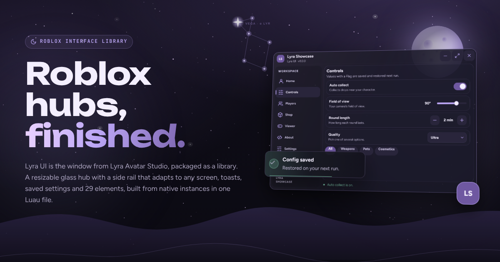

# Lyra UI

A native Roblox interface library: the window, navigation, controls and notifications of Lyra Avatar Studio, packaged so any script can use them. One Luau file, built from plain Roblox instances, with no assets to upload.



- **Resizable window** with a corner grip, a live size badge and a remembered size.
- **Responsive side rail**: labels on wide windows, an icon rail on medium ones, a drawer on phones.
- **Flight animation** into a draggable floating button, plus a shortcut key, a chat command and the "open the Roblox menu 3 times" shortcut to bring it back.
- **Toasts**, a **confirm dialog** with countdown and a **status line**.
- **29 elements**: toggles, sliders, steppers, dropdowns, inputs, keybinds, chips, lists with drag-to-reorder, picture grids, a 3D model preview and more.
- **Saved settings**: give an element a `Flag` and its value is restored on the next run.
- **Five themes**, switchable live, and `Lyra.AddTheme` for your own. 

## Install

```lua
local Lyra = loadstring(game:HttpGet("https://raw.githubusercontent.com/lyraEz/Library-UI/main/src/Lyra.lua"))()
```

The raw URL only works while the repository (or wherever you host `src/Lyra.lua`) is public.

## Quick start

```lua
local Window = Lyra:CreateWindow({
    Title = "My Hub",
    Subtitle = "by you  ·  v1.0",
    ChatCommand = "hub", -- /hub or /e hub reopens the window
})

local Main = Window:Tab({Title = "Main", Icon = "star"})
Main:Section("Main", "Your features go here.")
Main:Toggle({Title = "Enabled", Flag = "Enabled", Callback = function(on) print(on) end})
Main:Slider({Title = "Power", Min = 0, Max = 100, Default = 50, Suffix = "%", Flag = "Power"})

Window:SettingsTab()
Window:Notify({Title = "Loaded", Text = "Press RightControl to hide.", Kind = "success"})
```

More in [`examples/`](examples): `minimal.lua` and `showcase.lua`, which uses every element.

## Documentation

The full reference (window options and methods, every element, themes, flags, icons, chat commands) is in [`site/docs.html`](site/docs.html). The website in [`site/`](site) is plain HTML, CSS and JavaScript with no build step: open `site/index.html` locally or host the folder on any static host (GitHub Pages, Cloudflare Pages, Netlify).

## Development

```
tests/run.sh path/to/luau
```

The tests run the library with the Luau CLI against a small stand-in of the Roblox API (`tests/mock.lua`). They build the showcase, click through every element, resize, drag, close and reopen the window, switch themes and check the saved config. They fail on misspelled properties or enum items, wrong value types, use of destroyed instances and errors inside callbacks. CI runs them on every push and pull request.

```
src/Lyra.lua          the library
examples/             minimal and showcase hubs
tests/                mock Roblox API, scenario and runner
site/                 website and documentation
```

## Credits

Made by [lyraEz](https://github.com/lyraEz). Icons: [Lucide](https://lucide.dev) (ISC) and the GitHub and Discord marks from [Simple Icons](https://simpleicons.org) (CC0).
